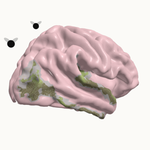
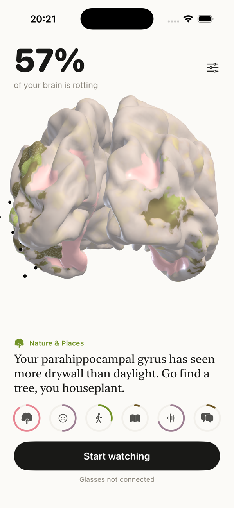

<p align="center"></p>

# BrainRot 🧠🪰

**Watch your brain rot in real time — and get roasted until you touch grass.**

<p align="center"></p>

BrainRot is an all-day brain wearable built on **Oakley Meta Vanguard** smart glasses and Meta FAIR's **TRIBE v2** brain encoding model. Every couple of minutes the glasses grab a few seconds of first-person video and your phone grabs audio. TRIBE v2 predicts how your cortex would respond (20,484 points on the fsaverage5 surface), we fold that into six brain regions, and anything you don't use **decays**. A 3D brain in the app visibly rots — mould colonies, sagging tissue, flies — and a deeply condescending AI pushes notifications telling you exactly how to fix it.

> *"Doomscrolling on a sunny Sunday? Your parahippocampal place area is rotting into sludge."*
>
> *"An actual outdoor vista. Your retrosplenial cortex is stunned you remembered what three dimensions look like."*

Built solo in a few hours at a hackathon.

## How it works

```
Oakley Meta Vanguard ──(Meta Wearables Device Access Toolkit, BT)──▶ iPhone app (SwiftUI)
   3.5 s clip @ 7 fps                                                 + 15 s phone-mic audio
                                                                       │ every 2–3 min, in your pocket
                                                                       ▼
                                                    Modal (H100) · FastAPI
                         ┌─────────────────────────────┬──────────────────────────────────┐
                         │ TRIBE v2 (V-JEPA 2 + w2v-BERT │ Gemini vision "perceive":        │
                         │ + Llama 3.2) → predicted fMRI │ scores the raw frames + transcript│
                         │ on 20,484 cortical vertices   │ per region (trees, faces, talk…) │
                         └──────────────┬──────────────┴───────────────┬──────────────────┘
                                        └──── blended z-score per region ┘
                                                         │
                                rot model: health decays (half-life), strong stimuli heal
                                                         │
                                 threshold crossed → Gemini writes a rude, anatomically
                                 precise roast → local push notification on the phone
```

**Regions** (Destrieux atlas on fsaverage5): Nature & Places (PPA/RSC/OPA) · Faces & Social (FFA/STS/TPJ) · Movement (MT+/EBA) · Reading (VWFA) · Sound & Speech (Heschl's/STG) · Language (Broca's + temporal language network).

**Why the hybrid score?** Low-res 4-second clips through anatomical ROIs were noisy — a desk facing a window of buildings lit up scene areas as much as a tree-lined street. Grounding TRIBE's prediction with a vision model's read of the actual frames (65/35 blend) made rot and recovery track reality.

### The all-day part
- **Background survival:** the app records phone-mic audio continuously into a ring buffer, which keeps iOS from suspending it; the audio also feeds TRIBE's auditory/language branches.
- **Glasses won't start a camera stream from the background**, but an open stream survives a lock — so the stream is opened in the foreground on Start and kept alive at 7 fps / 360p.
- **Dead-man switch:** a local notification is re-armed every capture; if iOS kills the app, it fires ("You killed me. Your brain is now rotting unsupervised.").
- Measured glasses drain with the stream open: ~55%/hr.

### The app
- Real fsaverage5 cortex in SceneKit; per-region rot is a shader uniform driving colour (pink → grey → bruise → mould), procedural mould colonies, fuzz, tissue sag, and a green pulse when a region heals. Flies orbit anything past 80%.
- Six health rings (full = healthy), tap any ring or the brain for detail: rot %, the cure, what the glasses saw, what the mic heard.
- A timeline strip of the whole session — drag to scrub the day and watch the brain rot and recover.

## Repo layout
```
ios/       SwiftUI app (xcodegen project.yml), Meta Wearables DAT 1.0.1 via SPM
backend/   Modal app: TRIBE v2 inference, Gemini perceive + roasts, rot model, API
           export_mesh.py builds ios/BrainRot/Resources/brain_mesh.json from fsaverage5
```

## Running it

### Backend (Modal)
Needs a Hugging Face token with access to `meta-llama/Llama-3.2-3B` and a Gemini API key (billing on — the free tier runs out fast).
```bash
modal environment create brainrot
modal secret create brainrot-hf HF_TOKEN=... --env brainrot
modal secret create brainrot-gemini GEMINI_API_KEY=... --env brainrot
BRAINROT_WARM=1 modal deploy -e brainrot backend/app.py
```
Endpoints: `POST /capture` (multipart frames + audio), `GET /timeline`, `GET /thumb/{id}`, `POST /reset`, `GET|POST /admin/params` (live tuning). ⚠️ No auth — this is a hackathon build; don't leave it deployed.

### iOS
Needs Xcode 26, an iPhone, [xcodegen](https://github.com/yonaskolb/XcodeGen), the Meta AI app, and glasses with **Developer Mode** enabled in the Meta AI app.
```bash
cd ios
cp Local.xcconfig.example Local.xcconfig   # then set your team ID, bundle prefix and backend URL
xcodegen generate && open BrainRot.xcodeproj
```
Signing identity and the backend URL live only in `Local.xcconfig`, which is gitignored. The committed project builds as `com.example.brainrot` with no team set, so the simulator works straight away; pick your team in Xcode (or set `DEVELOPMENT_TEAM` in `Local.xcconfig`) to run on a device.

In the app: Settings → Connect glasses → Grant camera permission → Start watching → lock your phone. Launch with the `-demoRot` argument to preview the rot visuals without a backend.

## Limitations (it's a hackathon build)
- **The hosted backend is offline.** To try it, deploy your own (below). It needs an H100-class GPU and costs about $4/hr while warm.
- **No auth on the API.** Anyone with the URL can post captures or reset state. Add auth before leaving it deployed.
- **While BrainRot holds the camera stream, the glasses' own capture button doesn't work.** Also, only one 360p frame per capture is kept server-side.
- **Rot is a model of a model.** TRIBE v2 predicts an *average* brain's fMRI response from short low-res clips, mapped through anatomical (not functional) regions and blended with a vision model's read of the scene. It's a fun mirror, not neuroscience about *your* brain.
- **The iOS app can't go on the App Store yet**, because Meta's Device Access Toolkit is still in developer preview. Install from Xcode.
- **Needs Gemini billing.** The free tier (~20 requests/day/model) runs out in under an hour of 2-minute captures.

## Credits & licences

BrainRot's own code is [MIT](LICENSE). The pieces it builds on have their own terms:
- [TRIBE v2](https://github.com/facebookresearch/tribev2) — Meta FAIR (check its licence; weights are reportedly non-commercial).
- [Meta Wearables Device Access Toolkit](https://github.com/facebook/meta-wearables-dat-ios).
- fsaverage5 surface & Destrieux atlas via nilearn / FreeSurfer.
- Roasts by Gemini. Insults are not medical advice; TRIBE predicts an *average* brain's response to what you see and hear — it does not read your mind.
